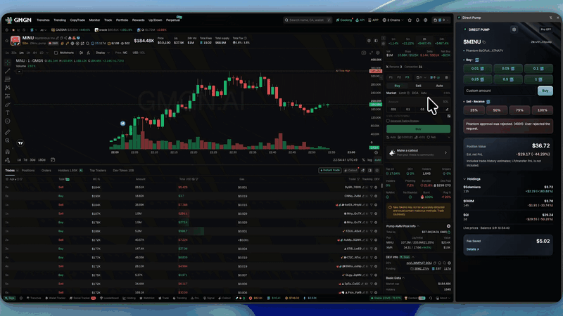
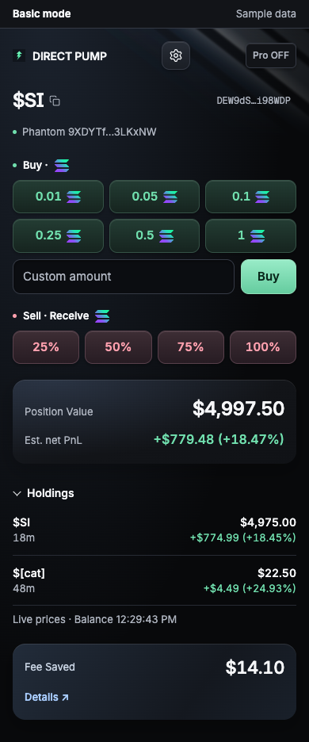
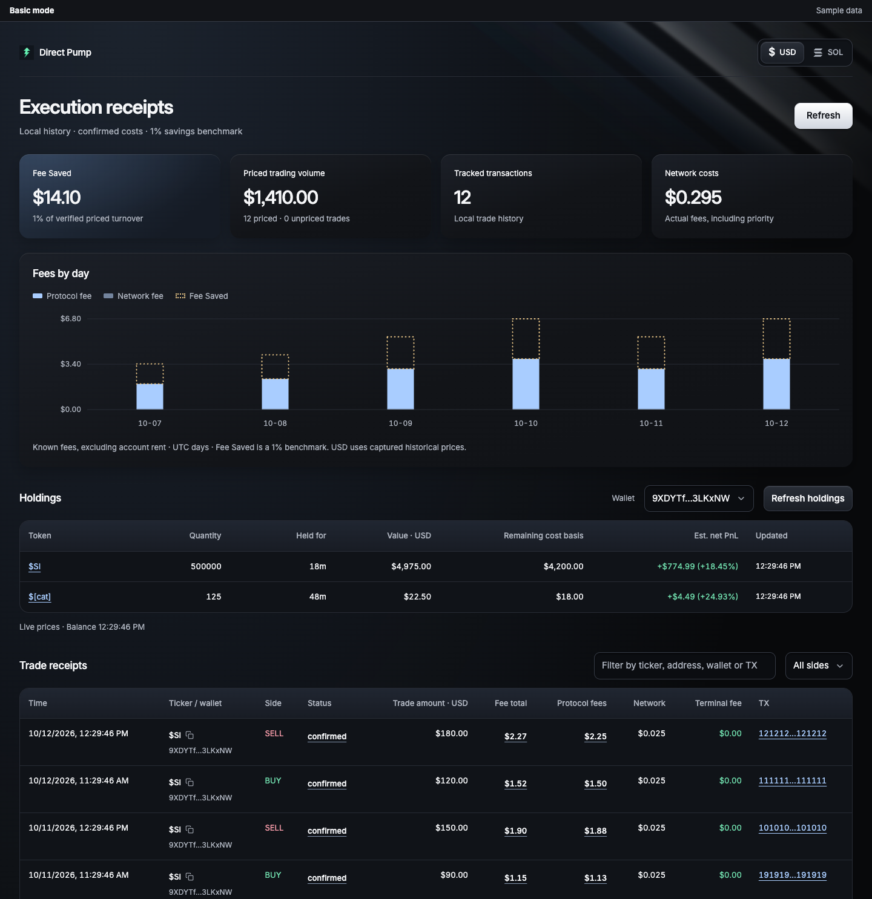
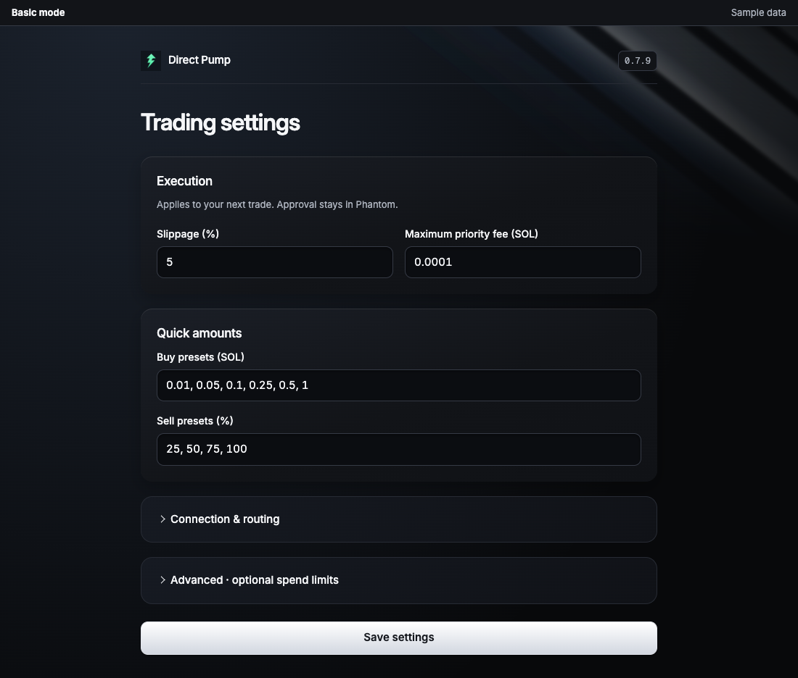

<p align="center">
  
</p>

<h1 align="center">Direct Pump</h1>

<p align="center"><strong>Keep the terminal. Skip the terminal fee.</strong></p>
<p align="center">Your execution layer for Axiom, GMGN, and FOMO</p>
<p align="center"><strong>0% added terminal fees. Phantom-approved. Open source</strong></p>
<p align="center">Trade supported Solana tokens without leaving the charts you already use</p>
<p align="center"><a href="https://chromewebstore.google.com/detail/direct-pump/ipklpacekegiifhkfgmlgojjokdjocfh">Install from Chrome Web Store</a> · <a href="#basic-vs-pro">Basic / Pro</a> · <a href="Docs/PROJECT.md#pro-setup">Set up Pro</a> · <a href="https://t.me/+bWgImSypdyBiODNl">Feedback</a></p>

### Basic mode · Trading panel

<p align="center">
  
</p>




## Why I built it

I spent years working as a crypto trader. More recently, I became interested in the memecoin market and started trading with AXIOM and GMGN. Both are extremely convenient for discovering tokens and following charts, but I felt their trading fees were too high.

My workaround was to discover a token on AXIOM or GMGN, copy its address, open Pump.fun, paste the address, and trade there. Repeating that process was slow, tedious, and inconvenient. In a market where entry and exit timing matters, switching between pages became a real source of friction.

**I wanted to trade the token I was already looking at, directly from that page.**

So I built Direct Pump. It keeps the discovery tools I already use and adds execution, holdings, and fee visibility in a side panel. It started with manually approved Phantom trades in Basic mode and grew to include self-hosted conditional orders in Pro mode.

## Core features

Both modes recognize the current Solana token on GMGN, AXIOM, and FOMO Family, so you can trade without leaving the token page. Direct Pump adds no platform or referral fee; protocol fees, network and priority fees, and account setup costs may still apply.

### Basic

- **Quick SOL buys and percentage sells.** Use presets or a custom SOL amount to buy, and sell 25%, 50%, 75%, or 100% of your holdings. Basic keeps manual Phantom approval for every trade.
- **Holdings and estimated net PnL.** View tracked holdings, their value and age, and estimated net returns that account for cost basis and estimated exit costs. USD and SOL displays are available.
- **Average entry on the chart.** Shows an `Avg Entry` line on supported charts when confirmed holdings and fills can be verified, using the chart's token-price or market-cap axis.
- **Execution receipts.** Inspect protocol and network costs, transaction status, and Solscan links. The dashboard groups daily fees and locally tracked receipts.

`Fee Saved` is a comparison benchmark: **1% of verified turnover with recorded USD pricing**, treated as a hypothetical additional terminal fee. It is not a claim about another platform's current rate or your actual net profit. Estimated PnL and page prices may differ from execution results.

### Pro

- **Conditional orders.** Self-hosted execution supports USD market-cap (MC) limits, take profit, stop loss, TP/SL brackets, trailing exits, and up to ten split-exit steps. Buy orders can attach an exit strategy that activates after a confirmed fill.
- **Instant trading.** Market orders submit directly by default; Limit orders require confirmation by default. Set Market and Limit confirmation independently in Settings, or choose to skip future confirmations from an order review.
- **Trading profiles.** Save up to eight profiles with SOL buy presets, percentage sell presets, slippage, priority fees, network budgets, and order expiry. Switch profiles directly in the Trade tab.
- **Hotkeys.** Enable hotkeys for the current panel session and hold Space with a configured buy/sell key to use a preset. Assign up to eight keys per side. Browser shortcuts are configured through Chrome's extension shortcuts page.
- **Positions and holdings.** Track current value, fee-inclusive SOL cost basis, realized PnL, net open PnL, and unrecovered SOL for assets traded through Pro. Position details show USD estimates alongside SOL values, average entry cost, and available/reserved token quantities.
- **Sell Initials.** Estimate and review the token quantity needed to recover outstanding SOL from available holdings. Insufficient inventory or incomplete history blocks recovery. Market changes may leave a remainder, and no additional sell is automatic.
- **Order tracking.** See estimated USD order values, remaining split-exit percentages, and trailing high/current/trigger MC. Edit, pause, or cancel open orders from the Orders tab.

## Basic vs Pro

Basic and Pro are two execution modes in the same extension. Pro currently uses a **self-hosted personal server**. A managed subscription service is not available yet.

| Feature | Basic | Pro |
| --- | :---: | :---: |
| SOL Buy / Percentage Sell Presets | ✅ | ✅ |
| Holdings & Estimated Net PnL | ✅ | ✅ |
| Instant Trade | ❌ | ✅ |
| Independent Market / Limit Confirmation Settings | ❌ | ✅ |
| Trading Profiles | ❌ | ✅ |
| Preset Hotkeys & Browser Shortcuts | ❌ | ✅ |
| Realized PnL & Unrecovered SOL | ❌ | ✅ |
| Sell Initials | ❌ | ✅ |
| Limit Orders | ❌ | ✅ |
| TP/SL & Trailing | ❌ | ✅ |
| Split Exit | ❌ | ✅ |
| Entry Protection | ❌ | ✅ |
| USD Order Values & Remaining Split-exit Percentages | ❌ | ✅ |
| Trailing High / Current / Trigger MC | ❌ | ✅ |
| Edit / Pause / Cancel Open Orders | ❌ | ✅ |
| Background Orders | ❌ | ✅ |
| Chrome / Telegram Alerts | ❌ | ✅ |

`Instant Trade` skips a separate Phantom approval. Registered orders run while your server and signer are online.

Use **Basic** for trades you approve yourself, or **Pro** for reviewed conditional orders and exit strategies. Pro does not import your Phantom key. [Set up Pro and explore its screens →](Docs/PROJECT.md#pro-setup)

### Pro · Orders

Review open orders with estimated USD values, remaining split-exit percentages, and trailing high/current/trigger MC. Orders run while your personal server and signer are online.


## Basic mode screenshots

### Execution receipts and fees



### Trading settings

Configure buy/sell presets, slippage, priority fees, RPC, and optional spend limits. API keys are entered in an extension-owned settings page.



## Quick start

### 1. Install from Chrome Web Store

1. Open [Direct Pump on the Chrome Web Store](https://chromewebstore.google.com/detail/direct-pump/ipklpacekegiifhkfgmlgojjokdjocfh) in Chrome.
2. Click **Add to Chrome** and confirm the installation.
3. Pin Direct Pump to the toolbar. Open a supported Solana token page and click its icon to open the side panel.

### 2. Use Basic

Connect Phantom and review your RPC, slippage, fees, and presets in Settings. Choose a buy amount or sell percentage, then inspect and approve the transaction in Phantom.

Supported direct SOL routes do not require a Jupiter key. Non-SOL pairs and routed venues require **your own Jupiter API key**, subject to your API plan. Supporting a token page does not guarantee every token, liquidity source, or route is tradable.

### 3. Explore Pro

You can browse Pro without a server. Real execution requires pairing your personal server, unlocking the signer on its private console, and explicitly enabling Pro.

[Pro setup guide and screenshots →](Docs/PROJECT.md#pro-setup)

## Execution and funds

Basic retains manual Phantom approval for each trade. Pro executes registered orders through a separate server wallet. Closing the browser does not stop Pro orders. Pro OFF takes effect after the server acknowledges pausing unsubmitted orders; signed or uncertain attempts remain tracked.

Slippage limits and order conditions do not guarantee a fill or execution price. Uncertain orders retain their reservations. Follow the [recovery procedure](Docs/PROJECT.md#orders-and-recovery) rather than placing a compensating order or deleting records.

## Development and documentation

WXT · Vanilla TypeScript · Chrome Manifest V3 · Solana. One side panel and shared execution logic, without a frontend framework.

To build from source, install Node.js **24 LTS** and npm, then run:

```sh
git clone https://github.com/superb43/direct_pump.git
cd direct_pump
npm ci
npm run verify
```

Open `chrome://extensions` in Chrome, enable **Developer mode**, choose **Load unpacked**, and select `.output/chrome-mv3`. After rebuilding, reload the existing extension and refresh the token page. Avoid uninstalling it if you want to retain settings and local receipts.

```sh
npm run check:docs  # Local documentation links and anchors
npm run check       # Extension and server type checks
npm test            # Offline tests
npm run build       # .output/chrome-mv3
npm run build:pro   # server-dist/cli.mjs
npm run verify      # Run the checks and builds above
```

Run `npm run test:sites` separately for the site DOM gate. Network tests are opt-in; offline verification performs no real signing, trading, or deployment.

- [Pro setup](Docs/PROJECT.md#pro-setup) · [Operations and recovery](Docs/PROJECT.md#pro-operations)

Share feedback and your experience on [Telegram](https://t.me/+bWgImSypdyBiODNl).

## Open-source license and participation

Original Direct Pump application code is licensed under **GPL-3.0-only**.
Commercial use, modification and redistribution are permitted under the GPL;
covered distributions must provide the applicable Corresponding Source and
retain the required notices. See the [project license and full GPL text](Docs/PROJECT.md#copyright-and-license)
and [third-party notices](Docs/licenses/NOTICES.md). Third-party code and assets retain
their original licenses.

[Project guide](Docs/PROJECT.md): architecture, Pro setup, contribution rules,
security, community conduct and release procedures.

Report ordinary bugs through GitHub Issues. Report wallet, signing, authorization
or credential vulnerabilities privately using the security policy. Never include
private keys, seed phrases, pairing codes, API tokens or wallet databases in an
issue, pull request, screenshot or diagnostic attachment.
