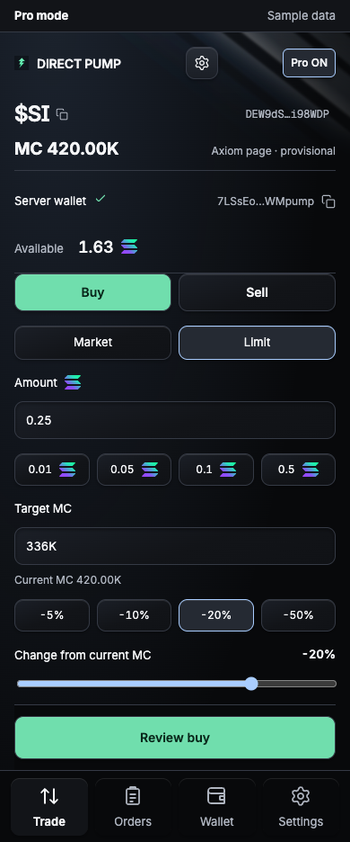
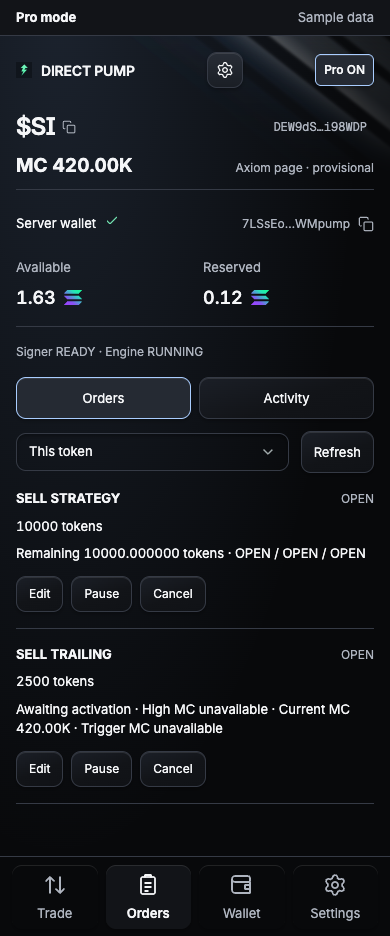
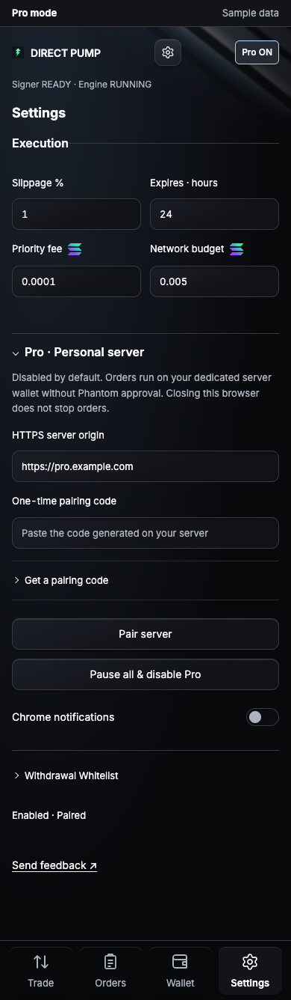
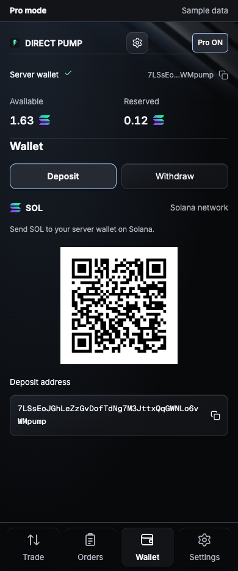
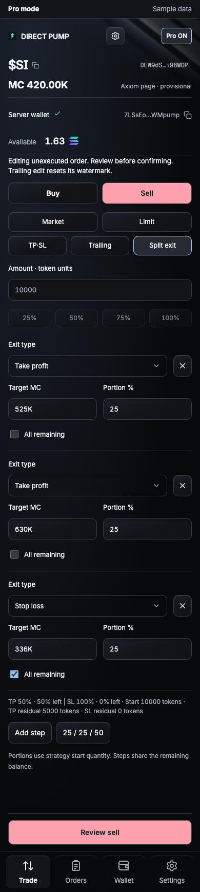

# How to set up Pro

[← README](../README.md) · [Operations and recovery](PRO.md)

Pro uses **your own server and a separate trading wallet**. You review and register orders in the panel; the server signs and executes them when their conditions are met. Basic's Phantom wallet and manual approvals remain available. A managed subscription service is not available yet.

This guide targets a personal Linux server. Complete the [extension installation](../README.md#quick-start) first. You can browse Pro without a server; preview mode does not execute orders or read remote balances.

## Pro mode screenshots

All images in this guide show **Pro mode with synthetic sample data**, not actual trading results. Basic screenshots are in the [README](../README.md).

<table>
  <tr><th>Pro · Limit buy</th><th>Pro · Orders</th></tr>
  <tr>
    <td></td>
    <td></td>
  </tr>
</table>

## Prerequisites

- A Linux server with Node.js 24 LTS and npm.
- An HTTPS origin with a valid TLS certificate, such as `https://pro.example.com`.
- A Solana HTTPS RPC. Routed venues also require your own Jupiter API key.
- Separate OS accounts for the signer and API. The examples use `dp-signer`, `dp-api`, and a shared `dp-socket` group.
- A separate encrypted-backup location and buy/network budgets you choose yourself.

**Setup creates a new server wallet. It does not ask for or import your Phantom private key.**

## 1. Build the server

```sh
git clone https://github.com/superb43/direct_pump.git
cd direct_pump
npm ci
npm run verify
```

The executable is `server-dist/cli.mjs`. The commands below assume you have placed the build at `/opt/direct-pump`; substitute your installation path. Run `node server-dist/cli.mjs help` to inspect the current CLI.

## 2. Separate accounts and directories

Run these example commands as an administrator. Skip account/group creation if they already exist.

```sh
sudo groupadd --system dp-socket
sudo useradd --system --no-create-home --gid dp-socket --shell /usr/sbin/nologin dp-signer
sudo useradd --system --no-create-home --gid dp-socket --shell /usr/sbin/nologin dp-api
sudo install -d -m 0700 -o dp-signer -g dp-socket /srv/direct-pump-signer
sudo install -d -m 0700 -o dp-api -g dp-socket /srv/direct-pump-api
sudo install -d -m 0750 -o dp-signer -g dp-socket /run/direct-pump
sudo install -d -m 0700 -o dp-signer -g dp-socket /secure-backups/direct-pump
```

| Resource | Ownership and access |
| --- | --- |
| `/srv/direct-pump-signer` | Signer only; directories 0700, files 0600 |
| `/srv/direct-pump-api` | API-owned state and logs; directory 0700 |
| `/run/direct-pump` | Signer-owned, shared-group access, 0750; API cannot write the directory |
| `signer.sock` | Shared connection socket, 0660 |
| `admin.sock` | Inside the private signer directory, 0600 |
| Encrypted backup | Separate from the working keystore; keep the passphrase separately too |

`/run` may be cleared on reboot. Configure your service manager to recreate `/run/direct-pump` with the same ownership and permissions at startup. Both accounts must be able to read the executable and build directory. The API account must not be able to modify signer code or the keystore.

## 3. Create the server wallet and set budgets

Enter budgets as **integer lamports**. `1 SOL = 1,000,000,000 lamports`.

| Option | Meaning |
| --- | --- |
| `--max-buy-lamports` | Maximum buy input per order |
| `--daily-buy-lamports` | Maximum daily buy input; must be at least the per-order cap |
| `--max-network-lamports` | Network-fee and account-setup ceiling; minimum 5,000 lamports |

Replace the `YOUR_…` placeholders with your RPC and budgets. Choose limits for your own operating requirements.

```sh
sudo -u dp-signer node /opt/direct-pump/server-dist/cli.mjs setup \
  --state-dir /srv/direct-pump-signer \
  --backup-file /secure-backups/direct-pump/wallet-key.enc \
  --rpc-url YOUR_HTTPS_SOLANA_RPC \
  --max-buy-lamports YOUR_PER_ORDER_CAP \
  --daily-buy-lamports YOUR_DAILY_CAP \
  --max-network-lamports YOUR_FEE_AND_SETUP_CAP \
  --socket-path /run/direct-pump/signer.sock \
  --admin-socket-path /srv/direct-pump-signer/admin.sock
```

Enter the passphrase twice in an interactive terminal. Input is not echoed. The CLI verifies the encrypted backup and prints the public server ID and wallet address. The signer remains locked. Do not run `setup` again against an already configured directory.

Keep another copy of the encrypted backup in a secure, separate location. The API needs only a configuration copy:

```sh
sudo install -m 0600 -o dp-api -g dp-socket \
  /srv/direct-pump-signer/config.json \
  /srv/direct-pump-api/config.json
```

**Do not copy `key.enc`, the passphrase, or signer authentication/signing databases into the API directory.** The configuration copies must agree on server ID, wallet, and socket paths.

## 4. Start the signer and API

Use separate terminals. For ongoing operation, configure your OS service manager to keep both processes running. These commands do not install background services.

```sh
# Terminal A: signer account
sudo -u dp-signer node /opt/direct-pump/server-dist/cli.mjs signer \
  --state-dir /srv/direct-pump-signer
```

```sh
# Terminal B: API account
sudo -u dp-api node /opt/direct-pump/server-dist/cli.mjs serve \
  --state-dir /srv/direct-pump-api
```

The API binds only to **`127.0.0.1:8788`** by default. Use your configured port if you changed it with `setup --port`. The signer starts locked, so starting these processes alone does not start automatic trading.

### HTTPS connection

Configure your reverse proxy to connect the HTTPS origin to the API:

- `https://pro.example.com`, with a valid certificate, forwards to `http://127.0.0.1:8788`.
- Preserve `/v1/…` and `/v2/…` paths, authentication headers, and request bodies.
- Forward the `/v1/events` SSE stream without response buffering and with suitable stream timeouts.
- Apply request-size and time limits. Expose only the HTTPS proxy; never expose Unix sockets publicly.

Proxy installation and certificate issuance depend on your server environment. Enter the **HTTPS origin** in the browser, rather than the API's loopback HTTP URL.

## 5. Pair the browser

Generate a code from a new signer-account terminal. Pairing is available while the signer is locked.

```sh
sudo -u dp-signer node /opt/direct-pump/server-dist/cli.mjs pair-code \
  --state-dir /srv/direct-pump-signer
```

1. Open **Pro · Personal server** in Direct Pump Settings. It is also accessible through Pro's **Settings** destination.
2. Enter your address under **HTTPS server origin**.
3. Paste the returned code into **One-time pairing code**.
4. Click **Pair server** and allow the extension to access that server.

Codes expire after **five minutes** and can be used **once**. Issue a separate code for each browser. Pairing authenticates the connection; it does not unlock the signer or start the engine.



> This sample screen is already paired. `https://pro.example.com`, the wallet, and all displayed values are examples.

## 6. Unlock and enable Pro

Run this on the private signer console. Enter the passphrase in the terminal, never in the browser.

```sh
sudo -u dp-signer node /opt/direct-pump/server-dist/cli.mjs unlock \
  --state-dir /srv/direct-pump-signer
```

Explicitly select **Enable Pro** or the paired **Pro ON** control in the panel. Confirm the signer is `READY` and engine is `RUNNING`. Unlocking alone does not resume the engine.

After a restart or signer lock, unlock again and explicitly resume the engine. Previously paused individual orders require a separate resume in **Orders**.

## 7. Deposit and register your first order

Open **Wallet → Deposit** to inspect the server wallet's full address and QR. It is separate from your Phantom balance. Compare the address with your trusted confirmation screen, fund it separately, and wait for the panel to show the confirmed balance. Allow for network fees and account setup costs.



In **Trade**, choose Buy/Sell and an order type, then enter the quantity and MC conditions. Inputs such as `250K` and `1.2M` are supported. Select **Review** and inspect the token, wallet, quantity, conditions, slippage, network budget, and expiry. Use **Confirm & register** to register the reviewed order.

Page MC is provisional. The server verifies MC using the executable quote price and on-chain supply. Relative percentages become an absolute MC target when entered; subsequent market movement does not rewrite that target.

### Split exits and entry protection

An exit strategy attached to a buy activates using the **actual confirmed fill quantity**. Its protection lifetime starts at confirmed entry, rather than when the buy order was registered. Entry and protection can reserve separate network budgets; check the total upfront reserve in the review.

The sample split strategy takes profit on 25% at MC 525K and another 25% at 630K, then stops out the remaining quantity at 336K. These are illustrative conditions, not trading recommendations. Strategy percentages refer to the original strategy quantity; **All remaining** refers to that strategy's residual quantity.



The **Orders** screen shown at the top of this guide exposes edit, pause, and cancel actions. Review changes before confirming them. Uncertain execution continues to retain its reservation.

## 8. Save a recipient and withdraw

1. Open **Settings → Pro · Personal server → Withdrawal Whitelist** and enter a name and full receiving address.
2. Click **Review recipient** and compare the full address with the receiving screen of your trusted wallet.
3. Check the confirmation box and select **Save reviewed recipient**. To change an address, add a new recipient instead of overwriting the old one.
4. In **Wallet → Withdraw**, select the saved recipient, SOL or a supported token, and an amount.
5. Review the full destination, asset, amount, and costs before approving.

Only unreserved funds are available for withdrawal. **Max** accounts for existing reservations and the reviewed fee/account rent. A withdrawal does not automatically cancel orders or globally pause the engine.

## Optional routing and alerts

| Server environment variable | Purpose | Process |
| --- | --- | --- |
| `DP_JUPITER_API_KEY` | Jupiter key for routed venues | Signer and API |
| `DP_TELEGRAM_TOKEN` | Telegram bot token | API |
| `DP_TELEGRAM_CHAT_ID` | Destination chat ID | API |
| `DP_TELEGRAM_THREAD_ID` | Optional topic ID | API |

Use your service manager's private environment configuration. Keep secrets out of documentation, screenshots, Git, and CLI arguments. Basic's Jupiter setting is separate from the server environment. Supported direct SOL routes do not require a Jupiter key.

Enable Chrome notifications in Settings and grant notification access. Telegram delivery runs on the server and can continue after browser closure. Alerts may be delayed or duplicated during retries; an alert is not final execution evidence.

## Stop, restart, and troubleshoot

Closing the browser does not stop Pro orders. **Pro OFF** takes effect after the server acknowledges pausing unsubmitted orders. If that response is uncertain, the panel does not report a completed stop. Already signed or uncertain attempts remain tracked.

Lock the signer from its private console:

```sh
sudo -u dp-signer node /opt/direct-pump/server-dist/cli.mjs lock \
  --state-dir /srv/direct-pump-signer
```

For pairing failures, unavailable servers, process locks and uncertain results,
use [Troubleshooting](PRO.md#troubleshooting) and [Orders and recovery](PRO.md#orders-and-recovery).
Never delete or edit financial journals to release reservations or submit a
replacement transaction to compensate for an uncertain result.
